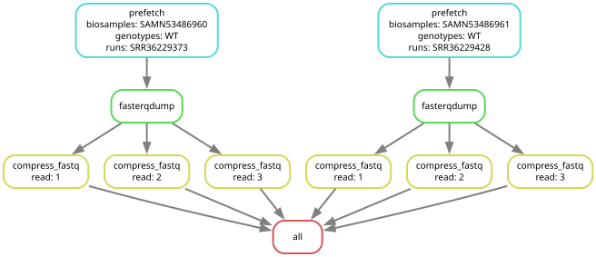
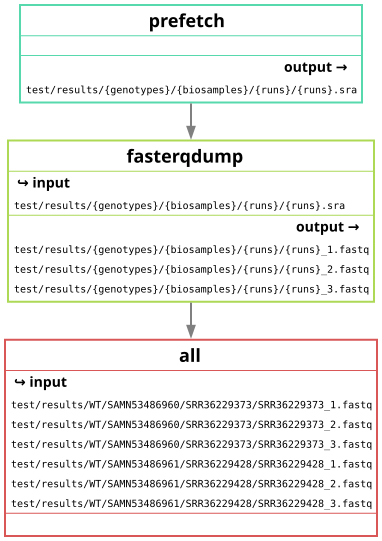

# sra-meta-fetch

Snakemake pipeline that uses the meta data from a single-cell RNA sequencing repository in the NCBI GEO to download and extract fastq sequences. As of date, only the Illumina platform is supported for this pipeline. The SRA files are separated by genotype, biosample, and then SRA ID. Output will be .fastq files that can be found in the results directory of the workflow.

Required dependencies to run:

    1. conda
    2. snakemake

Test:
snakemake --cores 4 --use-conda --configfile "test/config.yaml"

Run with user provided meta.csv:
snakemake --cores 4 --use-conda --config META="your/path/meta.csv"

<table>
  <tr>
    <td align="center"> <em>Figure 1. Directed acyclic graph (DAG)</em></td>
    <td align="center"> <em>Figure 2. DAG displaying I/O files</em></td>
  </tr>
</table>